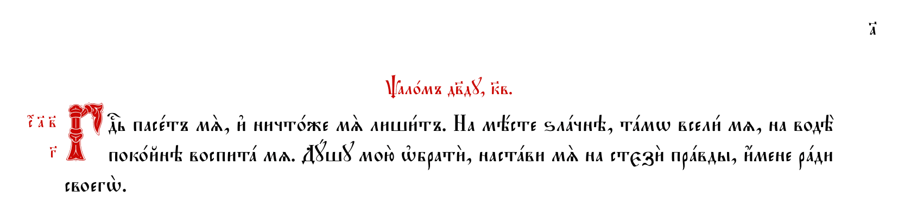

# slavonic-render

Typeset Church Slavonic texts using a Markdown-like syntax, to PDF or HTML.
Written in pure Go.

## An example

This is the document [`examples/psalm22.md`](examples/psalm22.md):

```
---
DocumentTitle: Ѱало́мъ к҃в
---
|=Ѱало́мъ дв҃дꙋ, &{num 22}.=

^{{ include "cu/psalms/022.md" | numberVerses | verseRange 1 3 }}
```

When rendered as a PDF, the top of the first page looks like this:



The lines between the two `---` are the front matter, which holds the
document's settings (see [Front matter](#front-matter)). Here it sets
the document's title, which is stored in the PDF's metadata and is not
printed on the page.

The first line of the text is centred (`|`) and red (`=…=`), and the
number in it is written in Cyrillic numerals (`&{num 22}`). The text of
the psalm is included from a separate file: the template takes its first
three verses and numbers them in the margin. The `^` gives the paragraph a
drop cap.

## Features

- **Church Slavonic typography.** It uses the fonts of the
  [Ponomar Project](https://sci.ponomar.net/) and the TeX hyphenation
  patterns of [cu-tex](https://github.com/slavonic/cu-tex). Numbers and
  page numbers can be written in Cyrillic or in Arabic numerals.
- **Service-book layout.** Rubrics in red, drop caps, incipits, margin
  notes, footnotes, running headers, catchwords and ornaments.
- **PDF and HTML output.** The PDF is a set of typeset pages, ready to
  print. The HTML is the same source as a single self-contained page, with
  the font embedded and a dark mode that follows the device's setting. It
  leaves out what belongs to a printed page, such as the running header
  and the page numbers.
- **Documents assembled from many files.** Go templates can include a
  psalm from its own file, number its verses and select paragraphs. The
  same document can be written in several languages.
- **Tables of contents.** Leaders, links, and page numbers, which are
  filled in after the pages have been laid out.
- **Self-contained.** There is no TeX and no CGO. The PDF is typeset with
  [boxesandglue](https://github.com/boxesandglue/boxesandglue) and
  [textshape](https://github.com/boxesandglue/textshape) (a pure-Go port
  of [HarfBuzz](https://github.com/harfbuzz/harfbuzz)), and the fonts, the
  hyphenation patterns and the ornaments are embedded.

## Quick start

You need Go (the version named in [`go.mod`](go.mod)) and a clone of this
repository. Nothing else is required.

```
go run ./cmd/slavonic-render pdf examples/styles.md styles.pdf
go run ./cmd/slavonic-render html examples/styles.md styles.html
```

`examples/styles.md` is a specimen of every style. Each style is shown in
Church Slavonic and then in English, with a caption that names its markup.
Reading it side by side with its PDF is the quickest way to learn the
markup.

---

The rest of this page is reference:

- [Markup syntax](#markup-syntax) and
  [Inline expressions](#inline-expressions): how a document is written.
- [Front matter](#front-matter) and
  [Template functions](#template-functions): a document's settings, and
  how it is assembled from several files.
- [The command](#the-command): the flags, the text size and the HTML
  page.
- [How it works](#how-it-works): one document followed through every
  stage.
- [Use as a Go library](#use-as-a-go-library).

## Markup syntax

The markup is a dialect of Markdown, parsed by
[goldmark](https://github.com/yuin/goldmark). It differs from it: some
constructs mean something else here, and some are errors. Each construct
means what this section says it means, and the styles are specific to this
typesetter.

The basic constructs are these:

- `#`: a title. The first title in a document also gives the document its
  title (see [Front matter](#front-matter)).
- `##`: a heading. Deeper levels (`###` and so on) are set the same as
  `##`.
- Paragraphs.
- `>`, a minor paragraph, and `***`, a thematic break. Both are described
  in the table of paragraph prefixes below.
- `\` at the end of a line: a hard line break.
- `[text](#name)`: a link to an anchor in the document.
- `` `text` ``: literal text. The text between the backticks is printed as
  it is written, in the same style as the text around it, and no markup is
  read inside it. The captions of `examples/styles.md` use it to show the
  markup they describe. Backticks do not protect `{{ … }}` actions or
  `&{num …}`, because the template stage handles both before the markup is
  read. To print them, write `{{"{{"}}` for the opening braces, and
  `\&{num …}` outside backticks.
- The backslash escape. A backslash before a punctuation character makes
  that character ordinary text (`\*`, `\=`, `\<`, or `\^` at the start of
  a paragraph). The backslash itself is not printed.

There is no bold and no italic, as in the Church Slavonic books,
handwritten or printed: their text is in one face (each Slavonic font here
has only a regular one) and in two colours, black and the rubric's red.
`*text*` is the plain style, and `_text_` prints its text unchanged.

The following cause an error, which quotes the offending text. To print
one of them as ordinary text, escape it with a backslash, as shown in the
second column:

| Causes an error | Written as text |
|-----------------|-----------------|
| A list: a line that begins with `- `, `+ ` or `* `, or with a number followed by `. ` or `) ` (`1. `). Note that an indented paragraph is written `+text`, with no space; `+ text` is a list. | `\- `, `\+ `, `\* `, `1\. `, `1\) ` |
| A fenced code block: the lines between two lines of ```` ``` ```` or `~~~`. | `` \``` ``, `\~\~\~` |
| An indented code block: a line indented by four spaces or a tab, after a blank line. | Remove the indent. Spaces at the start of a line are never printed. |
| A `<` that begins HTML or a URL. That is a tag, a closing tag or a comment (`<br>`, `</p>`, `<!-- … -->`), or a URL or an e-mail address followed by `>` (`<https://…>`, `<name@host>`). | `\<br>`, `\<https://…>` |
| A link that leaves the document: `[text](URL)`, or a link definition, `[name]: URL`. | `\[text](URL)`, `\[name]: URL` |
| A directive `&{…}` whose name is not listed in the tables below. | `\&{…}` |
| Text in the same paragraph as an ornament, ``. | Put the ornament in a paragraph by itself. To print the mark itself, write `!\[](name)`. |

Any other `<` needs no backslash (`<>`, `a < b`, `<5>`, `<слово>`).

### Actions, directives, expressions

Three forms written with braces can appear in a document's text. Each has
its own name in this README, and each is read at a different stage:

| Form | Name | What it is | When it is read |
|------|------|------------|-----------------|
| `{{ … }}` | Template action | Assembles the text: it includes a file, numbers verses or sets a key (see [Template functions](#template-functions)). | First, by the template stage. No template action remains in the text that results. |
| `&{name …}` | Directive | An instruction to the typesetter at that point in the text. The names come from a fixed list: a margin note, a leader, an anchor (see [Inline marks](#inline-marks)). Nothing is computed. | With the rest of the markup, by the markup parser. |
| `${…}` | Expression | A value that is computed and printed in place: a key, a page number, the psalms on a page (see [Inline expressions](#inline-expressions)). | Last, by the renderer. In the PDF, this is when the pages are laid out. |

The `$` marks a value, as in the shell's `${var}`. The `&` can be read as
"and here, do this". Expressions are evaluated last because a page number,
or what a page contains, is known only once the pages are laid out.

One directive is read earlier than the others: `&{num …}` is read by the
last step of the template stage (see [Numerals](#numerals)).

### Paragraph prefixes

A prefix is written at the very start of a paragraph (column 0).

| Syntax | Meaning |
|--------|---------|
| `\|text` | Centred paragraph. |
| `^text` | Drop cap: the first grapheme cluster becomes a decorative initial. |
| `+text` | Indented paragraph: all of its lines are indented on the left. |
| `> text` | Minor paragraph: slightly smaller text and leading. |
| `===` | Page break. |
| `***` | Thematic break: a blank line. |
| `%text` | Running header (PDF only): this line is printed at the top of every page from here on, except the document's first page, until the next `%` line. The `%` line prints nothing where it is written. Its `${…}` expressions are evaluated separately for each page (see [Page context](#page-context)). |
| `` | Ornament: one of the embedded ornaments, centred, in a paragraph by itself (see [Ornaments](#ornaments)). |
| `[^id]: text` | Footnote definition: the text of the footnote that `[^id]` refers to (see [Footnotes](#footnotes)). Inline marks (`=rubric=`, `*plain*`) work inside it. |

Another prefix can follow `>`: `> |text` is minor and centred, `> +text`
is minor and indented, and `> ^text` is minor with a drop cap.

### Inline marks

| Syntax | Meaning |
|--------|---------|
| `=text=` | Rubric: red text in the minor size. It can continue over more than one line of the source. |
| `*text*` | Plain text, used for instructions. It is set in a modern typeface (Carlito), at a smaller size, in the same colour as the rubric. |
| `~text` | Incipit: the first grapheme cluster after `~` is set in the rubric's colour, at the full size. Inside `=…=` it is simply part of the rubric. |
| `-text` | Inline indent: a horizontal space, at the start of a line or after a space. The text follows directly after the `-`. A `-` followed by a space (`word - word`) is an ordinary dash. |
| `${expr}` | Inline expression (see [Inline expressions](#inline-expressions)). |
| `[^id]` | Footnote reference: a bold superscript number (see [Footnotes](#footnotes)). |
| `&{margin text}` | Margin note: `text` is set in the outer margin, next to the line the directive is in. |
| `[text](#name)` | Link: everything inside the brackets is a PDF hyperlink to the anchor `name` (`&{anchor name}`). |
| `&{leader .}` | Leader: a space that fills the rest of the line with the glyph `.` repeated, so that the text after it is pushed to the right margin. The dots are spaced apart and line up in columns from one line to the next. This makes the row of dots between a title and its page number (see [A table of contents](#a-table-of-contents)). |
| `&{anchor name}` | Anchor: gives a name to the heading that follows it (in HTML, to the element that follows it), for use in `${page("name")}` and `[text](#name)`. It prints nothing. |
| `&{push key value}` | Page context (PDF only): appends `value` to the list `key`, for use in the running header (see [Page context](#page-context)). It prints nothing. |
| `&{num n}` | A number, such as `&{num сл҃г}` or `&{num 233}`, written in the document's numerals (see [Numerals](#numerals)). |

An `&{anchor …}` or `&{push …}` directive is written on a line by itself,
above the heading or paragraph it belongs to. That line is treated as a
separate paragraph, whether or not a blank line follows it, so the
paragraph below it keeps its prefix (`^`, `|`, `+`).

### Ornaments

`` places one of the embedded ornaments, centred, at a fixed
width. The names are `panel`, `line1`, `line2`, `line3`, `leaf2`, `leafs`,
`leafs3`, `leafs4` and `upleft`. Section 5 of `examples/styles.md` shows
each of them, and
[`internal/assets/svg/README.md`](internal/assets/svg/README.md) says
where they came from.

`name` is the name of an ornament, not of a file, so no other picture can
be placed. Anything written between the square brackets is ignored.

### Page context

The page context keeps track of things that change as the text flows from
page to page, such as which psalm is on the current page. Each key holds a
list, and there is one operation: `&{push key value}` appends a value to
the key's list. The last value on a page is carried over to the next page,
and a page break (`===`) empties every list.

A `%` running header can use these lists in its `${…}` expressions. For
example, after `&{push psalms а҃}`, a header can show the psalms on its
page with `${range(psalms)}`.

### Footnotes

A footnote has two parts: a reference `[^id]` in the text and a definition
`[^id]: text`. The two are matched by the id. The printed
numbers are assigned in order of first reference, regardless of the ids.
The footnote's text is set at the bottom of the page, under a rule, in the
italic of the plain style.

```
Ѡ҆ ст҃ѣ́мъ хра́мѣ се́мъ,[^hram] и҆ съ вѣ́рою...

[^hram]: Если литургия совершается не в храме, то прошение
произносится: =ѡ҆ ст҃ѣ́мъ мѣ́стѣ се́мъ.=
```

Inside the definition, `=…=` switches to the Church Slavonic font, just as
it does inside `*plain =cs= text*` elsewhere.

## Inline expressions

`${…}` holds an expression, which is evaluated by
[expr-lang](https://expr-lang.org/) when the document is rendered.

HTML has no pages, so `page()` is empty there, and the `%` running header,
whose expressions depend on what is on a page, is not rendered.

### Variables

In the body of a document, the names available to an expression are the
keys of the front matter. Each one holds its value as text: `${Feast}`
prints it, `${upper(Feast)}` passes it to a function, and
`${Feast == "Pascha" ? "…" : "…"}` compares it. A number is text as well,
so it is converted before any arithmetic: `${int(Tone) + 1}`.

A `%` running header is evaluated for each page. There the names are the
keys of the [page context](#page-context), which are lists:
`${range(psalms)}`, `${len(psalms)}`, `${first(psalms)}`.

### Functions

| Function | Meaning |
|----------|---------|
| `range(list)` | For a list of one element, returns that element. For a longer list, returns `"first–last"`. |
| `page("name")` | Returns the page number of the anchor `name`, written in the page numerals (`PageNumerals`). It is empty in HTML, which has no pages. |

The functions of expr-lang itself are available as well (`first`, `last`,
`upper`, `lower`, `trim`, `replace` and the rest). For example, a running
header can capitalize a clause with `upper`:
`${upper("{{ slice $h 0 1 }}")}{{ slice $h 1 }}`. Here the template's
`slice` separates the first letter from the rest of the value.

### A table of contents

An expression that refers to an anchor that has not been placed yet is
deferred, and it is resolved after all the content has been laid out. This
is what allows a table of contents to appear at the beginning of a
document:

```
+[~Каѳі́сма а҃ &{leader .} ${page("c1")}.](#c1) \
[~Каѳі́сма з҃і &{leader .} ${page("c17")}.](#c17)
```

Each of these indented lines has the title of a kathisma, a dotted leader,
and the page number at the right margin. The whole line, including the red
initial, is a link to the anchor.

A paragraph can be deferred in this way if it is plain, indented or
centred, and it may contain footnotes. A paragraph with a drop cap or a
margin note cannot be deferred. In the PDF, referring in such a paragraph
to a page further on causes an error that says so.

Any other failure in the body of a document (a name that is not a key, a
function given the wrong type) causes an error immediately, which gives
the expression and the reason. In the PDF, an anchor that does not exist
anywhere in the document is reported after the pages have been laid out.
In HTML, `page()` does not look for the anchor.

## Front matter

A document can begin with front matter: lines of the form `key: value`
between two `---` lines.

```
---
DocumentTitle: Ѱалти́рь
---
```

Every key is available to templates (as `{{ .Feast }}`) and to inline
expressions (as `${Feast}`). The keys in this table also configure the
rendering. Any other key is only data for the templates.

| Key | Meaning |
|-----|---------|
| `DocumentTitle` | The document's title, used in the PDF's metadata and in the HTML page's `<title>`. When it is not set, the title is the text of the first `#` heading. |
| `BodyFont` | The font of the body text. The default is `Ponomar`. |
| `DropCapFont` | The font of the drop cap (PDF). The default is `Indiction`. |
| `DropCapLines` | The number of lines the drop cap spans (PDF), a whole number. The default is `2`. |
| `DropCapOverhang` | The height of the drop cap as a multiple of the lines it spans (PDF). With `1.2`, the default, the drop cap is a fifth taller than those lines. |
| `Lang` | The document's language. It decides the default numerals and the `lang` of the HTML page, and templates can use it to choose which file to include (see [A document in several languages](#a-document-in-several-languages)). The default is `cu`. |
| `Numerals` | `cyrillic` or `arabic`: how the document writes its numbers (see [Numerals](#numerals)). The default is `cyrillic` when `Lang` is `cu`, and `arabic` for any other language. |
| `PageNumerals` | `cyrillic` or `arabic`: how the page numbers are written, in the footer and in a table of contents. The default is the value of `Numerals`. |

The front matter looks like YAML, but it is not YAML. A value is the text
after the first colon, exactly as written, including any quotes. There are
no lists and no nesting, and nothing in a value is evaluated when the file
is read.

Using a key that is not set causes an error. Go's templates print
`<no value>` for such a key, or `%!s(<nil>)` when the key is passed to
`printf`. The template stage fails if either of these is left in the
expanded text, and the error quotes the first line that contains it. The
same applies to every other error marker of `printf`; they all have the
form `%!…(…)`.

Only the front matter of the top-level file is used. The front matter of
an included file is removed and ignored, so an included file can use it
for notes, such as `source:` (where the text comes from).

### Fonts

`BodyFont` and `DropCapFont` each take the name of one of the embedded
Church Slavonic fonts ([`fonts/data/README.md`](fonts/data/README.md)
describes each of them):

- Text fonts: `Ponomar`, `Triodion`, `Pomorsky`, `Fedorovsk`, `Menaion`
  and `Monomakh`.
- Fonts made for drop caps: `Indiction` and `Vertograd`.
- Fonts made for titles: `Cathisma` and `Oglavie`.

There are no command-line flags for the fonts or for the proportions of
the drop cap, because these belong to the document. To try another font
for a single run, use `-set BodyFont=Triodion`. A font that is not
embedded, or a number that cannot be parsed, causes an error that names
it.

In HTML, the drop cap is set in the body font, so `DropCapFont` has no
effect there.

### Setting a key from the command line

`-set key=value` sets a key from the command line, overriding the front
matter. It can be repeated, it works for both formats, and it can set the
rendering keys as well. For example, `-set Lang=en` renders a document in
English: the numerals and the page's `lang` change with it, and so does
every include whose path uses `Lang`.

### Numerals

A document writes its numbers either in Cyrillic numerals («сл҃г») or in
Arabic numerals («233»), according to its `Numerals` key. When the key is
not set, a document in `cu` uses Cyrillic and a document in any other
language uses Arabic. `-set Numerals=arabic` prints a Church Slavonic
document with Arabic numbers, the way a reader pencils them in beside the
zachala.

`PageNumerals` overrides `Numerals` for the page numbers only, both in the
footer and in a table of contents (`page()`). `-set PageNumerals=arabic`
gives a Church Slavonic document Arabic page numbers, while everything
else stays Cyrillic.

Which pages carry a number is set by a flag and does not depend on the
numerals. `-page-numbers all` (the default) numbers every page. `leaf`
numbers the leaves, as the old books do: the number is printed on the odd
pages only, and both sides of a leaf share it. `none` prints no page
numbers.

**Marking a number.** A number in the text is marked as `&{num сл҃г}` or
`&{num 233}`; either form works. The last step of the template stage
rewrites it in the document's numerals, before the markup is parsed.
Because of this, the directive works anywhere: in a heading, in a margin
note (`&{margin На &{num і҃}:}`), in a page-context value
(`&{push psalms &{num ѳ҃}}`) or in the string of an expression.

**How Cyrillic numerals are written.** They are written in the canonical
form of the printed books: the titlo goes over the letter before the last
(or over the only letter), the numbers 11 to 19 are written with the units
first, and 70 is written «ѻ». The result is canonical whatever form the
directive contains: an «о» in place of «ѻ», a missing or misplaced titlo,
and letters in a different order are all corrected. A directive that
contains a letter with no numeric value causes an error that quotes it. A
typo that happens to be another numeral letter («слп» for «слг») cannot be
detected.

**A number computed by a template** is marked in the same way:
`{{ printf "&{num %d}" $n }}`. The directive can also be stored in a key
(`{{ set "Week" (printf "&{num %d}" $n) }}`), as long as the key is then
printed into the text, where the last step of the template stage finds it.

**Numbers generated by the typesetter** follow the same key. These are the
page numbers and the verse numbers produced by `numberVerses` (which, in
`cu` only, puts «сⷯ» before verse 1).

## Template functions

A document is a Go template
([`text/template`](https://pkg.go.dev/text/template)). Its `{{ }}`
actions are executed before the markup is read, and the result is plain
markup. In addition to what the template language itself provides
(`range`, `index`, `slice`, `len`, `printf`), these functions are
available:

| Function | Meaning |
|----------|---------|
| `include "path"` | Includes another template file and processes it. The path is relative to the including file. |
| `numberVerses` | Joins verses (which are separated by blank lines) into one paragraph. Each verse's number becomes a margin note (`&{margin …}`), written in the document's numerals. In a Church Slavonic document, «сⷯ» is put before the number of the first verse; in English nothing is. This depends on `Lang`, not on the numerals. |
| `firstVerseAsHeading` | Splits numbered text: the first verse becomes a centred rubric heading, and the rest becomes the body. It takes two optional arguments: a whole number N, which puts the first N verses in the heading, and `"dropcap"`, which gives the body a drop cap. |
| `verseRange start end` | Keeps only a range of the verses of numbered text. `start` and `end` are whole numbers counted from 1, and both are included. A range that goes outside the text causes an error. |
| `paragraphs` | Splits text into a list of its paragraphs (which are separated by blank lines, and are trimmed), for use with the template language's `range`, `index`, `slice` and `len` (see [Selecting paragraphs](#selecting-paragraphs)). |
| `set "key" "value"` | Sets a key for everything that is expanded after it: the rest of the file and any files included from that point on. It can also set the rendering keys of the [front matter](#front-matter) (`{{ set "DocumentTitle" "…" }}`). It prints nothing. |

Numbered text is the output of `numberVerses`, so `firstVerseAsHeading`
and `verseRange` must come after it:
`{{ include "cu/psalms/022.md" | numberVerses | verseRange 1 3 }}`.

### A document in several languages

`Lang` is a key like any other, and every template can read it (it is `cu`
when the front matter does not set it). A document that exists in several
languages has a separate tree of files for each language, and includes
files from the tree that `Lang` names. In `examples/`, for instance, the
trees `cu/` and `en/` are next to `styles.md`.

```
{{ include (print $.Lang "/psalms/022.md") }}
```

Write `$.Lang`, not `.Lang`, because inside `with` and `range` the dot
refers to something else. `-set Lang=en` then renders the same document in
English.

### Template example

This is a fragment of a Psalter, the opening of the second kathisma. The
psalm files it includes are not among the examples in this repository.

```
%Каѳі́сма в҃. Ѱало́мъ ${range(psalms)}.

&{anchor c2}
## Каѳі́сма в҃.

&{push psalms ѳ҃}
{{ include "psalms/009.md" | numberVerses | firstVerseAsHeading "dropcap" }}

|=Въ коне́цъ, ѱало́мъ дв҃дꙋ, і҃.=

&{push psalms і҃}
^{{ include "psalms/010.md" | numberVerses }}
```

- `&{anchor c2}` gives a name to the heading below it, for use in a table
  of contents: `${page("c2")}` returns its page number and `[text](#c2)`
  links to it (see [A table of contents](#a-table-of-contents)).
- Each `&{push psalms …}` adds the number of a psalm to the
  [page context](#page-context).
- The `%` running header reads the page context when a page is completed:
  `${range(psalms)}` gives the psalms on that page.

### Selecting paragraphs

`paragraphs` turns included text into a list, and the built-in functions
of the template language select from it: `index $t 2` is the third
paragraph, `slice $t 0 2` is the first two, and `len $t` is the number of
paragraphs. Indices start at 0, and `slice` does not include its end
index.

This is useful for a file that holds one ode of a canon, with one
troparion per paragraph. A label stays with its paragraph
(`=Бг҃оро́диченъ:= ~…`), and the irmos is kept in a separate file, so index
0 is always the first troparion. The count given by the Typikon then
appears literally in the template: "на в҃" is `slice $t 0 2`.

The example below is the resurrection canon "on 4": the irmos and three
troparia, each troparion preceded by its refrain. The files it includes
are not among the examples in this repository.

```
=І҆рмо́съ:= {{ include "canon/irmos1.md" }}

{{ $t := include "canon/ode1.md" | paragraphs }}

{{ range slice $t 0 2 }}
~Сла́ва гдⷭ҇и ст҃о́мꙋ воскрⷭ҇нїю твоемꙋ̀.

-{{ . }}
{{ end }}

~Прест҃а́ѧ бцⷣе, сп҃сѝ на́съ.

-{{ index $t 2 }}
```

- Keep `{{ range }}` and `{{ end }}` on lines by themselves. The body of
  the loop then starts and ends with a newline, so a blank line separates
  each iteration from the next.
- The paragraphs of the included file start directly with `~`. The
  including file adds the `-` indent.
- An index that is out of range causes an error, which gives the line
  number in the template.
- Printing the list itself gives `[a b c]`.

## The command

```
slavonic-render pdf  [flags] <input.md> <output.pdf>
slavonic-render html [flags] <input.md> [output.html]
```

There is one command, `slavonic-render`, with a subcommand for each
format. From a clone of this repository, it is run as
`go run ./cmd/slavonic-render`.

To install the command, so that it can be run from any directory:

```
go install github.com/grisha/slavonic-render/cmd/slavonic-render@latest
```

`go install` puts the binary in Go's `bin` directory, which is `~/go/bin`
unless you have changed it. That directory has to be on your `PATH`. The
binary needs no other files.

Flags go after the subcommand and before the input and output files. A
flag after the files is an error. `html` writes to standard output when no
output file is given. Progress is reported on standard error.

These flags work in both subcommands:

| Flag | What it does |
|---|---|
| `-set key=value` | Sets a key over the front matter (see [Setting a key from the command line](#setting-a-key-from-the-command-line)). |
| `-dump-md` | Writes the expanded markup to `<output>.debug.md`, next to the output file. |
| `-dump-ir` | Writes the parsed document, as JSON, to `<output>.debug.json`. |

The dump files are named after the output file, so `html` needs an output
file when it is asked for a dump. [How it works](#how-it-works)
shows what the two files contain.

The other flags belong to one format, and each subcommand accepts only its
own. `go run ./cmd/slavonic-render pdf -help` lists the flags of the PDF:
the text size, the margins, which pages are numbered, and others. `html`
has `-head` (see [The HTML page](#the-html-page)).

The PDF page has a single size: the width of A4 and the height of US
Letter, so that it prints on either paper without being clipped.

### Text size

A single flag, `-body-size` (default `14pt`), sets the size of everything.
`-body-size 18pt` gives the same page, enlarged. To see what a size looks
like, render `examples/styles.md` with it.

- Every other size is a fixed proportion of the body size: the rubric and
  minor text, the plain text, the footnotes, the headings and the title.
- Every vertical distance scales with it: the leading (which is generous,
  to leave room for the marks stacked above Slavonic letters), the space
  before headings and around rubric lines and ornaments, and the drop cap
  and its gap.
- A paragraph with no full-size text (one that is all rubric, like the
  centred `|=…:=` lines, or all plain) takes the leading of its largest
  text, in the same proportion.
- `-leading` and `-drop-cap-margin` override the derived values.
- The page geometry does not scale: the page size, the margins and the
  width of the ornaments stay the same.

The front matter sets fonts and the proportions of the drop cap, but never
a size, because the size is the reader's choice and not a property of the
text. The proportions themselves are defined in
[`pdfrender/proportions.go`](pdfrender/proportions.go).

### The HTML page

`slavonic-render html` writes a single file that needs nothing else. The
font and the style sheet are embedded in it, so it can be opened from disk
and sent as it is. On a screen, the page is dark when the device is set to
dark mode; when printed, it is light. The page has no script and no
controls of its own.

HTML has no pages, so anything that belongs to a page (the running header,
the page numbers) is left out, and a page break becomes a gap. In an
expression, `page()` is empty. Leaders are not rendered yet, so a line of
a table of contents consists of its title and its link.

To add your own styles, scripts or links to the page, pass `-head FILE`.
The HTML in that file is inserted unchanged at the end of the page's
`<head>`, after the style sheet. The page provides two things that a
script can set, both on the root element:

| On the root element | What it does |
|---|---|
| `--size` | A custom property: a factor applied to the text size. Every size and space in the text scales with it. |
| `data-theme` | An attribute, `light` or `dark`, that sets the page's theme regardless of the device's setting. Without it, the page follows the device. |

[`examples/menu.html`](examples/menu.html) is an example of such a file.
It adds a menu for the reader: a button in the corner of the page that
opens three rows (smaller text, larger text, dark mode) and remembers what
the reader chose.

```
go run ./cmd/slavonic-render html -head examples/menu.html examples/styles.md styles.html
```

## How it works

A document passes through three stages. The `pipeline` package runs them
for the command:

1. **Template expansion** (`template`): the front matter is read and the
   `{{ }}` actions are executed, which leaves plain markup.
2. **Markup to document** (`markup`): the markup is parsed into a list
   of blocks (`ir`).
3. **Rendering** (`pdfrender`, `htmlrender`): the blocks are laid out on
   pages, or written as HTML.

This section follows the document from the top of this page,
[`examples/psalm22.md`](examples/psalm22.md) (the opening of psalm 22),
through each stage:

```
go run ./cmd/slavonic-render pdf -dump-md -dump-ir examples/psalm22.md psalm22.pdf
go run ./cmd/slavonic-render html examples/psalm22.md psalm22.html
```

### The source

The source is a template: front matter, followed by markup that contains
`{{ }}` actions.

```
---
DocumentTitle: Ѱало́мъ к҃в
---
|=Ѱало́мъ дв҃дꙋ, &{num 22}.=

^{{ include "cu/psalms/022.md" | numberVerses | verseRange 1 3 }}
```

### 1. Template expansion

The front matter is read and the actions are executed. `include` brings in
the psalm's file. `numberVerses` joins its verses into one paragraph and
marks the start of each verse with a margin note. `verseRange` keeps the
first three verses. The last step rewrites the number marked `&{num 22}`
in the document's numerals, which here are Cyrillic (see
[Numerals](#numerals)). The result is plain markup with no template
actions left in it. `-dump-md` writes it to `psalm22.pdf.debug.md`:

```
|=Ѱало́мъ дв҃дꙋ, к҃в.=

^&{margin сⷯ а҃}Гдⷭ҇ь пасе́тъ мѧ̀, и҆ ничто́же мѧ̀ лиши́тъ. &{margin в҃}На мѣ́сте ѕла́чнѣ, та́мѡ всели́ мѧ, на водѣ̀ поко́йнѣ воспита́ мѧ. &{margin г҃}Дꙋ́шꙋ мою̀ ѡ҆братѝ, наста́ви мѧ̀ на стєзѝ пра́вды, и҆́мене ра́ди своегѡ̀.
```

Before the template is parsed, the front matter is replaced by a template
comment with the same number of lines, so that the line numbers in
template errors match those of the file.

### 2. Markup to document

[goldmark](https://github.com/yuin/goldmark) parses the markup, with
extensions for this dialect, and a walker converts the resulting tree into
the parsed document (`ir`): a list of blocks, each with its spans of text.
The prefixes `|` and `^` have become the kinds of the two blocks. The
`=…=` has become a flag on a span. The margin notes have become a list
next to the paragraph's text, and each note records the character position
it belongs to. `-dump-ir` writes the document to `psalm22.pdf.debug.json`:

```json
{
  "blocks": [
    {
      "kind": "centered",
      "content": [
        {
          "text": "Ѱало́мъ дв҃дꙋ, к҃в.",
          "rubric": true
        }
      ]
    },
    {
      "kind": "dropcap",
      "content": [
        {
          "text": "Гдⷭ҇ь пасе́тъ мѧ̀, и҆ ничто́же мѧ̀ лиши́тъ. "
        },
        {
          "text": "На мѣ́сте ѕла́чнѣ, та́мѡ всели́ мѧ, на водѣ̀ поко́йнѣ воспита́ мѧ. "
        },
        {
          "text": "Дꙋ́шꙋ мою̀ ѡ҆братѝ, наста́ви мѧ̀ на стєзѝ пра́вды, и҆́мене ра́ди своегѡ̀."
        }
      ],
      "notes": [
        {
          "charPos": 0,
          "text": "сⷯ а҃"
        },
        {
          "charPos": 44,
          "text": "в҃"
        },
        {
          "charPos": 111,
          "text": "г҃"
        }
      ]
    }
  ]
}
```

### 3. Rendering

The renderers depend only on the parsed document. A file of plain
markup with no template actions in it is rendered in the same way.

`htmlrender` writes each block as an element, inside a page that contains
the style sheet and the font:

```html
<article class="slavonic">
<p class="centered"><span class="rubric">Ѱало́мъ дв҃дꙋ, к҃в.</span></p>
<p class="dropcap"><span class="note lead">сⷯ а҃&nbsp;</span>Гдⷭ҇ь пасе́тъ мѧ̀, и҆ ничто́же мѧ̀ лиши́тъ. <span class="note">в҃&nbsp;</span>На мѣ́сте ѕла́чнѣ, та́мѡ всели́ мѧ, на водѣ̀ поко́йнѣ воспита́ мѧ. <span class="note">г҃&nbsp;</span>Дꙋ́шꙋ мою̀ ѡ҆братѝ, наста́ви мѧ̀ на стєзѝ пра́вды, и҆́мене ра́ди своегѡ̀.</p>
</article>
```

`pdfrender` lays out the same blocks on pages: it breaks and hyphenates
the lines, fits the drop cap to its lines, and places each note in the
margin next to its line. Deferred resolution comes last: expressions that
refer to anchors further on in the document (such as the page numbers in a
table of contents) are resolved after all the content has been placed.
This is the top of the page:


The listings above are the actual output of the command, and a test
checks that they stay so (`TestReadmeExample` in `pipeline`). The image is
made by hand from the PDF (with `pdftoppm`), so it is the one part of this
section that can fall out of date.

## Use as a Go library

The command is a thin wrapper. The work is done in the packages, which a
Go program can import. The module is at v0, and its API may still change.

| Package | What it holds |
|---------|---------------|
| `command` | The command as a function, `Main`, for a command of your own (see [A command of your own](#a-command-of-your-own)). |
| `pipeline` | Runs the stages together: `RunPDF` makes a PDF from a file, `RunHTML` makes an HTML page from a file, `ExpandFile` runs only the template stage, and `Title` returns the document's title. |
| `template` | The template stage: `ProcessTemplate`, with the options `WithFunc` and `WithData`. |
| `markup` | The markup parser: `Parse` returns the parsed document. |
| `ir` | The parsed document, with its blocks and spans. `markup` produces it and the renderers consume it. |
| `pdfrender`, `htmlrender` | The renderers. |
| `cu` | What the typesetter knows about Church Slavonic: the red of the rubrics, the hyphenation patterns and the Cyrillic numerals. |
| `fonts` | The embedded fonts. |

### A whole run

`pipeline.RunPDF` and `pipeline.RunHTML` do what the two subcommands do.
Both take a `pipeline.Config`, which names the input and output files and
holds the settings that the two formats have in common. The second
argument is specific to the format. For `RunHTML` it is the HTML to insert
at the end of the page's `<head>` (see [The HTML page](#the-html-page)).
For `RunPDF` it is a `pdfrender.DocumentConfig`, which holds the settings
of the PDF.

```go
cfg := &pipeline.Config{
	InputPath:  "service.md",
	OutputPath: "service.html",
	Set:        map[string]string{"Lang": "en"},
}
err := pipeline.RunHTML(cfg, "")
```

When `OutputPath` is empty, `RunHTML` writes the page to standard output.
[`command/command.go`](command/command.go) shows how a
`pdfrender.DocumentConfig` is filled in.

### Functions of your own

`template.WithFunc` adds a template function of your own. Pass it to
`template.ProcessTemplate` or `pipeline.ExpandFile`, or put it in
`pipeline.Config.Template` to use it for a whole run. Your functions are
called in the same way as the built-in ones. The package itself knows
nothing about them.

```go
md, fm, err := pipeline.ExpandFile("service.md", nil,
	template.WithFunc("upper", strings.ToUpper))
```

This is how a program gives its documents functions that this repository
does not have, for example one that fetches a text from a database. The
command in this repository registers no such functions.

### A command of your own

`command.Main` is the whole command as a function. A program that calls it
has the subcommands, the flags and the messages of `slavonic-render`, and
the usage and the error messages show the name of your program.

The argument of `Main` is a function that returns the template options for
a run. `Main` calls it after it has read the flags, and passes it the
`pipeline.Config` of the run. The functions you add can therefore depend
on the input file or on the `-set` keys:

```go
func main() {
	command.Main(func(cfg *pipeline.Config) ([]template.ProcessOption, error) {
		source := filepath.Base(cfg.InputPath)
		return []template.ProcessOption{
			template.WithFunc("upper", strings.ToUpper),
			template.WithFunc("source", func() string { return source }),
		}, nil
	})
}
```

`slavonic-render` itself is `command.Main(nil)`.

### An HTML page of your own

`htmlrender.RenderPage` writes the same page that `slavonic-render html`
writes. Its `bodyFont` argument is the name of the font for the text, and
an empty name gives Ponomar. Its `head` argument is the HTML that `-head`
reads from a file (see [The HTML page](#the-html-page)).

To build a page of your own, use `htmlrender.Render`, which writes only
the `<article>`, and `htmlrender.CSS`, which is its style sheet. The style
sheet names the font Ponomar but does not load it, so your page has to
declare the font. To set the text in another font, declare that font and
name it in the custom property `--body`, in a rule placed after the style
sheet:

```css
.slavonic {
	--body: "Triodion", serif;
}
```

Both functions take the front matter, which supplies the keys that the
document's expressions refer to.

## License

The code is under the Apache License 2.0 (`LICENSE`). The fonts, the
hyphenation patterns, the ornaments and the texts quoted in the examples
are the work of others and have their own licenses, which are listed in
`NOTICE`.
